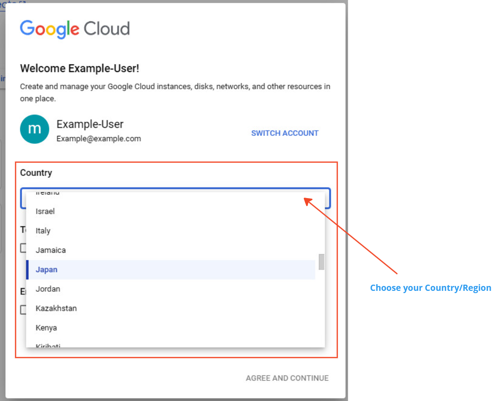
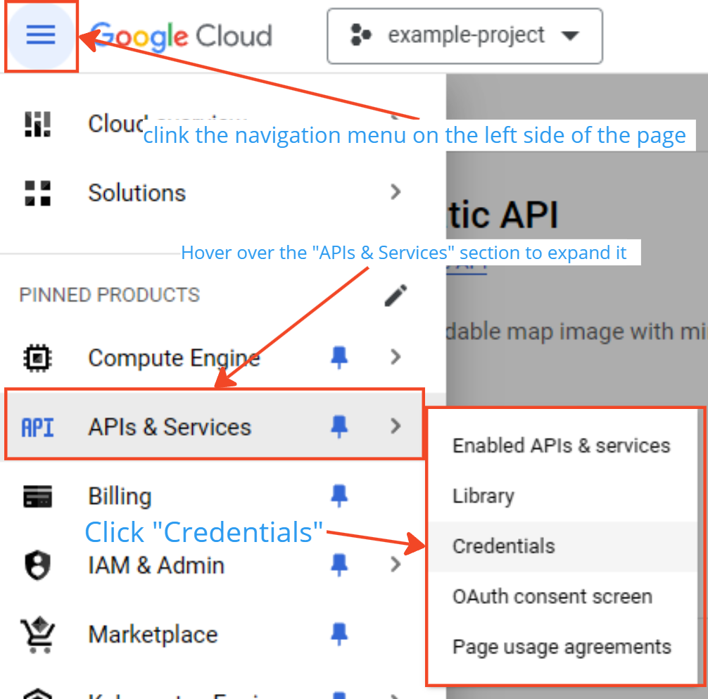

## What You'll Do

Create a Google Maps Static API key, restrict it, and place it in `App.config`.

To enable map features, create a Google Maps Static API key:

1. Open [Google Cloud Console](https://console.cloud.google.com/).
2. Create/select a project.
3. Enable Maps Static API.
4. Create an API key.
5. Restrict the key to local-dev usage and Maps Static API.
6. Put the key in `App.config`:

```xml
<add key="GoogleMapsApiKey" value="YOUR_LOCAL_DEV_API_KEY"/>
```




Previous: [Setup](/installation/setup/)  
Next: [Database](/installation/database/)
