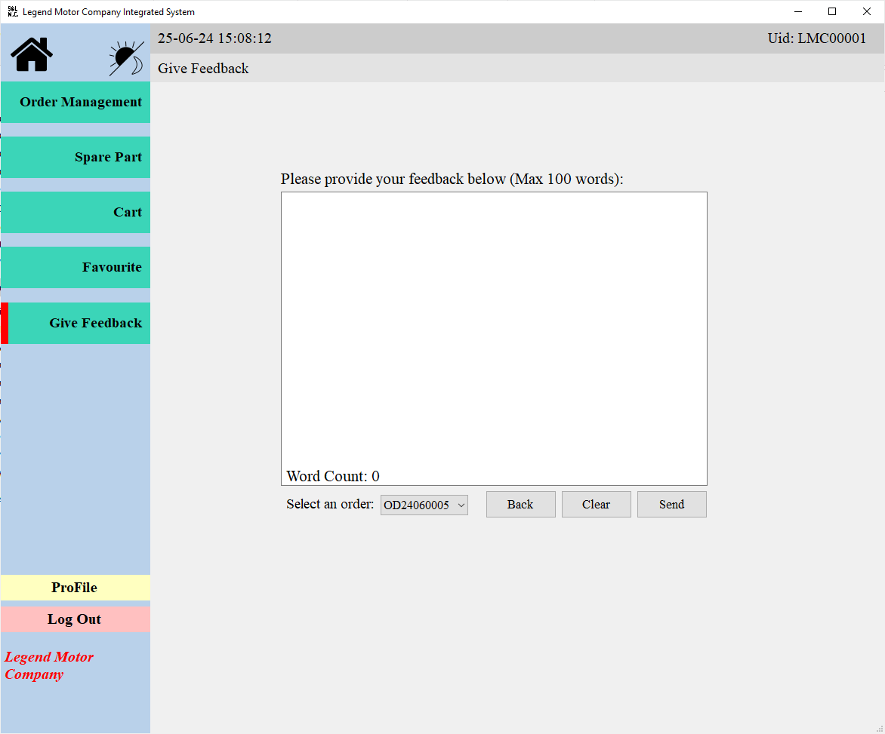

This page describes the feedback submission flow from navigation entry to completed form input.

## Context

Use this workflow when capturing user feedback inside the application.

## Workflow

1. Open the feedback area from system navigation.
2. Enter feedback details in the form.
3. Submit the feedback.

## Expected Result

- Feedback form accepts the submission and confirms that input is recorded.

