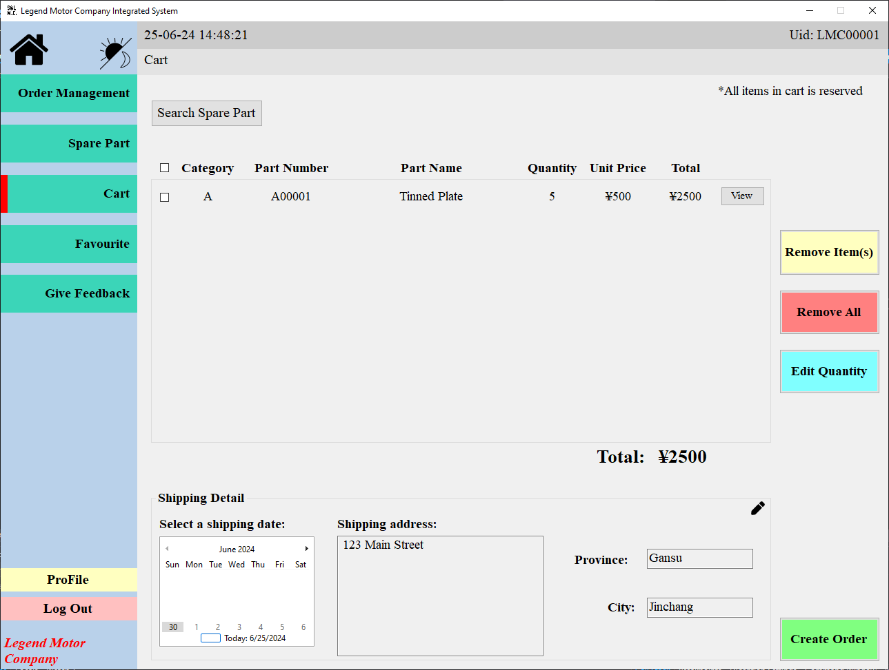

This page describes the product-to-cart flow for creating an order.

## Context

Use this workflow when validating customer purchase flow from product selection to cart confirmation.

## Workflow

1. Open on-sale product management.
2. Choose a product and add it to cart.
3. Open the cart and verify the selected product appears with expected values.

## Expected Result

- Added products appear in cart and are ready for order confirmation.

