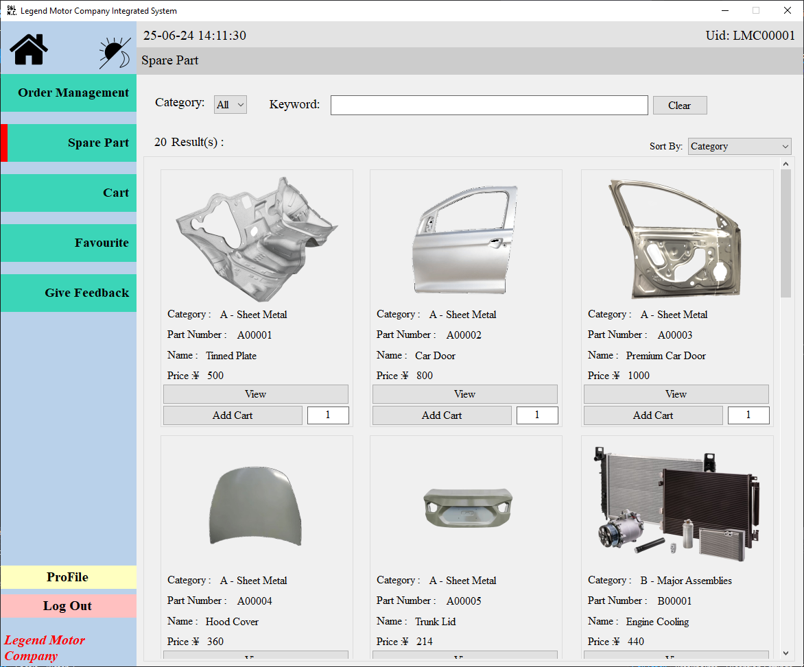
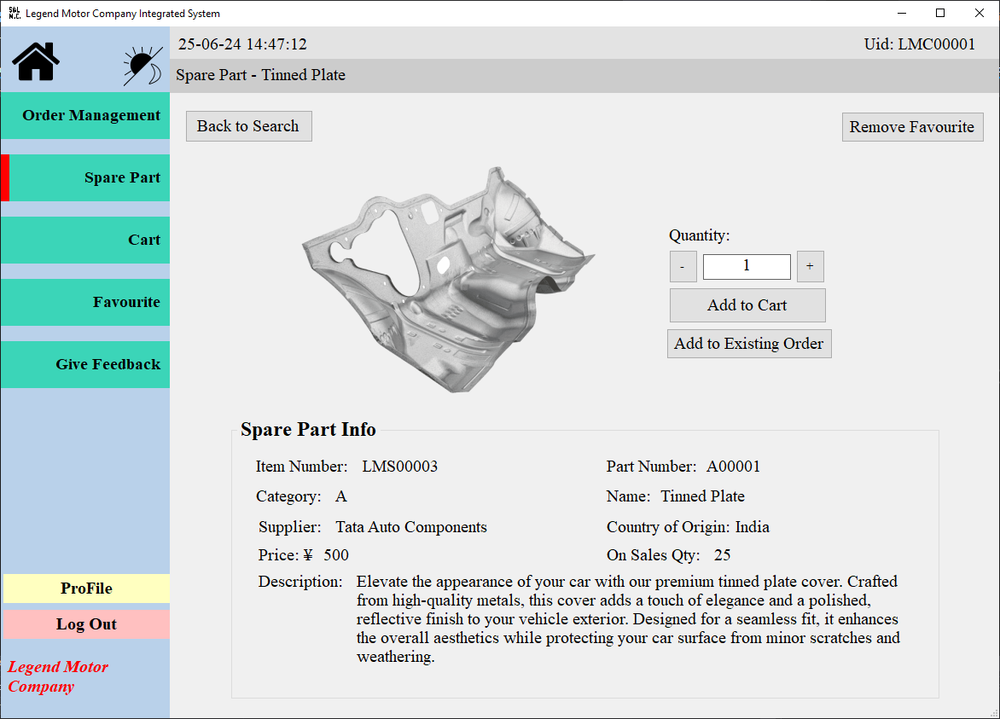

This page explains how to inspect stock items from list view to detail view.

## Context

Use this workflow when checking available spare parts or validating stock details.

## Workflow

1. Open the stock management area.
2. Browse the spare parts list.
3. Select a part to open its detail view.

## Expected Result

- The selected part detail screen shows the correct stock-related information.

