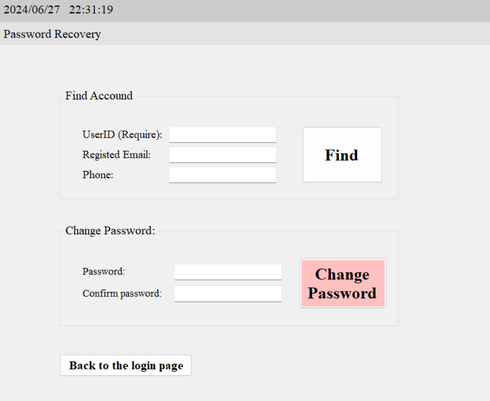

This page covers initial account access and the first system screens after login.

## Context

Use this workflow when a user needs to sign in, recover access, or confirm dashboard entry.

## Workflow

1. Open the login screen and sign in with valid credentials.
2. If needed, open the forgot-password flow to recover account access.
3. After successful sign-in, confirm the home/dashboard screen loads.

## Expected Result

- User reaches the home page and can access feature modules from the main navigation.

